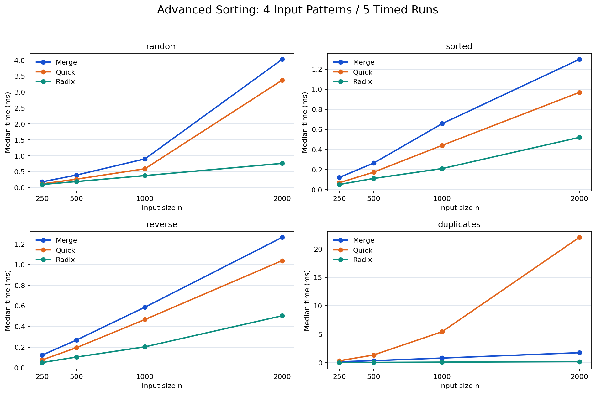
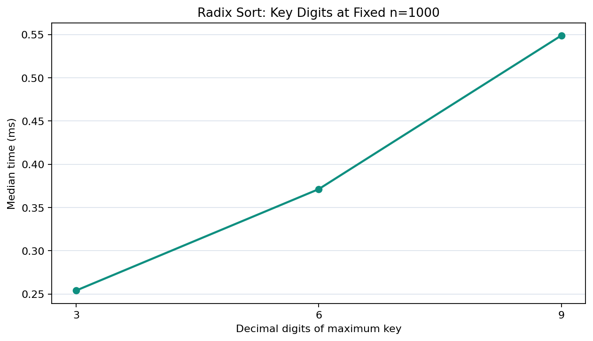
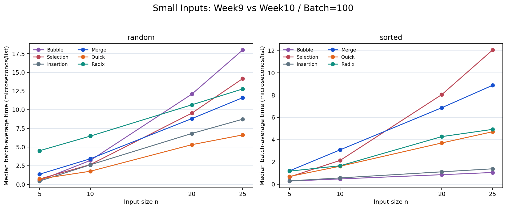

# Week10 — 고급 정렬 구현 및 비교

## 실행과 제출

`DS_10A.ipynb`는 Colab에서 위에서 아래로 모두 실행한다. 표준 라이브러리와 그래프용 matplotlib, 노트북 표시용 IPython을 사용한다. 저장된 결과는 검증용 Python 환경의 실제 값이며, 강의의 개인 실측 요구에 따라 **본인 Colab에서 전체 실행한 뒤 갱신된 CSV·그래프·analysis.md와 실행된 노트북을 내려받아 제출한다.** 최종 제출처는 LMS이다.

## 구현 계약

| 함수 | 입력 리스트 | 반환 | 키 제약 | 안정성 |
|---|---|---|---|---|
| merge_sort | 유지 | 새 리스트 | 비교 가능한 결정적 키 | 안정 |
| quick_sort | 직접 수정 | 같은 리스트 | 비교 가능한 결정적 키 | 불안정 |
| radix_sort | 유지 | 새 리스트 | 정확한 int형의 0 이상 키; bool·음수·실수 거부 | 안정 |

직접 구현 안에서는 sorted/list.sort를 사용하지 않는다. 정답 검증에서만 사용한다. 원래 빠른 정렬 셀의 불필요한 OS·IPython alias import를 제거했고 정렬 알고리즘은 유지했다. Quick은 **중간 위치 값을 마지막 위치로 옮기는 Lomuto**이며, 값의 중앙값을 선택하는 알고리즘이 아니다.

## 검증 결과

- 고급 정렬별 57개, 총 171개 기본 정확성·인터페이스 사례 통과.
- Merge·Quick의 음수 입력과 Radix의 음수·실수·bool 거부 확인.
- 첫 필드만 비교하는 레코드 정렬에서 순서·원소 보존·반환 계약을 확인하고 Quick의 불안정 반례를 기록.
- Week9의 세 기본 정렬을 저장소 노트북에서 직접 가져와 알고리즘별 48개, 총 144개 사례로 검증.
- 본 실험 240회·기수 실험 15회·작은 입력 240배치에서 정답을 확인. 작은 입력의 한 배치는 100개 정렬이며 모든 결과를 검증.
- 수기 추적의 Quick 피벗 4·최종 인덱스 2, Radix 세 패스, Merge의 병합 결과 확인.

## 본 실험: 4입력 × 4크기 × 3구현

무작위·정렬·역순·중복 포함 입력에서 n=250,500,1000,2000을 측정했다. 동일 원본·고정 시드·워밍업·무작위 실행 순서·5회 중앙값을 사용한다. 준비 복사와 검증·I/O는 제외하고 함수 내부 할당과 key 호출은 포함한다. 각 패널은 별도의 y축 범위를 사용하며 단위는 한 리스트 정렬의 ms이다.

## 기수 자릿수 통제 실험

n=1000을 고정하고 키 범위의 상한을 10³,10⁶,10⁹로 바꿔 실제 최대 키의 d=3,6,9를 확인했다. 고유 키 수도 기록하여 범위 변경에 따른 중복 분포 차이를 숨기지 않는다.

## 9주차와 작은 입력 비교

Week9의 bubble_sort·selection_sort·insertion_sort 원래 구현을 사용했다. n=5,10,20,25의 무작위·정렬 입력을 정렬한다. 매우 짧은 실행을 위해 100개를 한 배치로 측정한 평균을 만들고 다섯 배치 평균의 중앙값을 사용한다. 그래프 단위는 µs/리스트이며 본 실험의 ms와 구분한다.

## 수기 추적·이론·6개 문항 답안

[analysis.md](analysis.md)에 다음 항목의 실측 표와 해석을 포함했다.

1. 입력 유형별 승자와 구체적인 동작 원인.
2. T(2n)/T(n)과 n log n·n²·고정 자릿수 n의 증가 비율 비교.
3. n을 고정한 기수 자릿수 효과와 실험의 한계.
4. 중복 개선을 위한 3-way partition 선택 확장 설계.
5. 기본 정렬과 작은 n의 교차점 관찰 및 하이브리드 전략 설명.
6. 시간·보조공간·안정성·키 제약을 종합한 선택 근거.

병합의 분할 트리·병합 결과, Quick의 첫 분할 단계, 기수의 일·십·백 자리 표도 분석문과 노트북에 포함한다. 분석문은 현재 results에서 생성하므로 Colab 재실행 후에는 그 환경의 값으로 바뀐다. 3-way는 설계 설명이며 성능 CSV의 Quick은 기존 2-way 구현이다.

## 첨부 HTML 시각화

- [09.html](09.html): 정렬 7종 비교. 내려받아 브라우저에서 실행한다.
- [sorting-circles.html](sorting-circles.html): 숫자 동그라미의 분할·병합·버킷 이동을 단계별 관찰한다.

HTML은 첨부 원본 그대로 제공한다. 화면의 Quick 구현은 피벗 규칙과 분할 방식이 다를 수 있다. 특히 sorting-circles의 Lomuto는 마지막 원소, Hoare는 첫 원소 피벗이고 이 노트북은 중간 위치 원소를 끝으로 옮긴다. 따라서 첫 분할 배열·교환 횟수가 항상 같다고 가정하지 않는다. 애니메이션 대기·화면 갱신을 포함한 HTML 시간은 Python 벤치마크의 수치로 사용하지 않는다.

## 파일 목록

| 파일 | 내용 |
|---|---|
| `DS_10A.ipynb` | 실행된 자기완결 노트북; 분석문과 그래프 내장 |
| [sorting_algorithms.py](sorting_algorithms.py) | 고급 3종·Week9 기본 3종 재사용 모듈 |
| [analysis.md](analysis.md) | 실측 표·6개 답안·추적·복잡도 |
| [week10_benchmark.csv](week10_benchmark.csv) | 기본 실험 요약 48행; ms |
| [week10_benchmark_samples.csv](week10_benchmark_samples.csv) | 기본 실험 원시 측정 240행 |
| [week10_radix_digits.csv](week10_radix_digits.csv) | 기수 범위·자릿수 요약 3행 |
| [week10_radix_digit_samples.csv](week10_radix_digit_samples.csv) | 기수 원시 측정 15행 |
| [week10_smalln.csv](week10_smalln.csv) | 작은 n 비교 요약 48행 |
| [week10_smalln_samples.csv](week10_smalln_samples.csv) | 작은 n의 배치 측정 240행 |
| `week10_benchmark.png`, `week10_radix_digits.png`, `week10_smalln.png` | 실측 그래프 3장 |
| `09.html`, `sorting-circles.html` | 제공된 시각화 원본 |
| [test_results.txt](test_results.txt) | 검증 환경과 실행 출력 |

CSV 요약의 median/min/max는 대응 원시 표본에서 재계산하여 확인했다. 작은 n 원시 CSV의 elapsed_ms는 배치 평균의 1회 정렬 시간이고, batch_elapsed_ns는 100개 전체 시간이다. 그래프·분석은 이 CSV와 같은 데이터에서 생성했다. 실제 바이트 단위 메모리 사용량·온라인 채점·LMS 제출을 수행했다고 주장하지 않는다.
