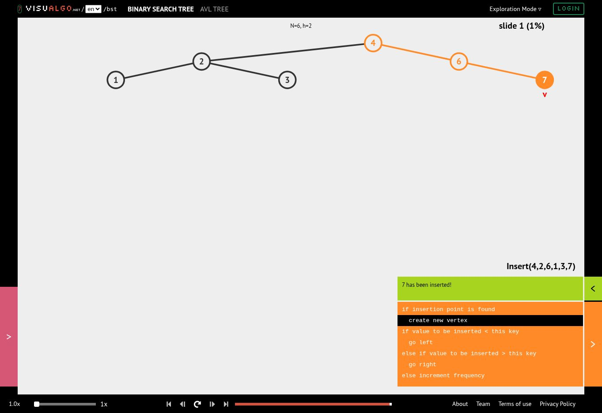
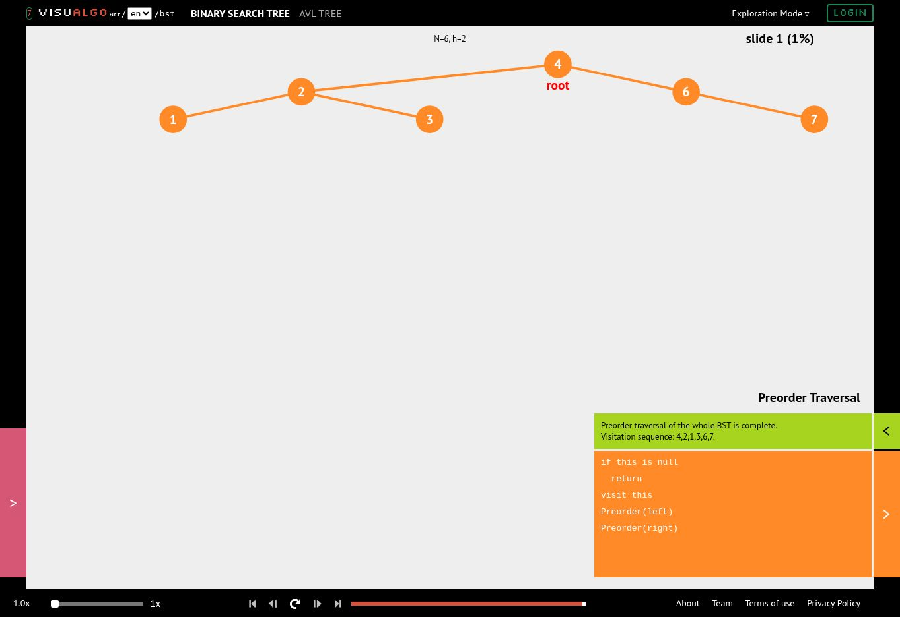
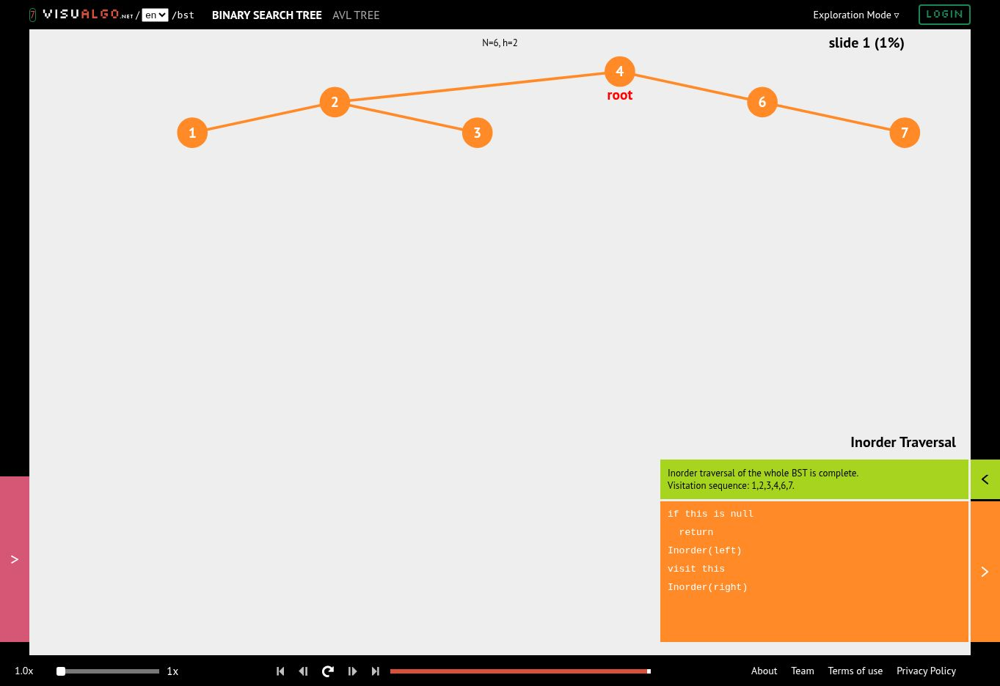
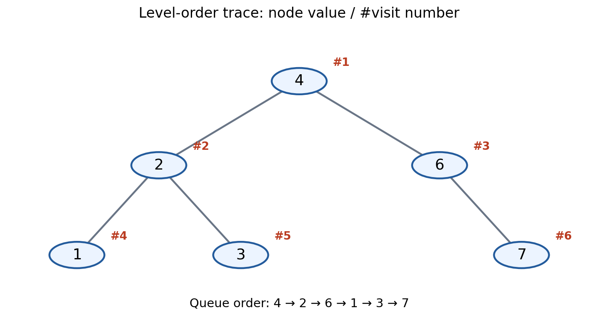

## 테스트 결과

기존 예시·경계 사례·과제 테스트가 통과했다. 추가로 아래 7개 사례에서 전위·중위·후위·레벨 순회, 반복 전위 일치, 높이·노드 수·리프 수를 각각 assert로 검증했다.

| 사례 | 높이 | 노드 수 | 리프 수 |
|---|---:|---:|---:|
| 빈 입력 [] | -1 | 0 | 0 |
| 단일 노드 [9] | 0 | 1 | 1 |
| 완전 트리 [1,2,3,4,5,6,7] | 2 | 7 | 4 |
| 마지막 레벨 일부 [1,2,3,4] | 2 | 4 | 2 |
| 오른쪽 편향 1→2→3 | 2 | 3 | 1 |
| None 루트 [None,2] | 1 | 2 | 1 |
| 중간 None·중복 값 [1,None,1,4] | 2 | 4 | 2 |

7개 노드 완전 트리의 출력은 다음과 같다.

```text
preorder  [1, 2, 4, 5, 3, 6, 7]
inorder   [4, 2, 5, 1, 6, 3, 7]
postorder [4, 5, 2, 6, 7, 3, 1]
levelorder [1, 2, 3, 4, 5, 6, 7]
```

## 구현 방법과 복잡도

`build_complete_tree(values)`는 리스트를 레벨 순서로 해석한다. 빈 리스트이면 빈 트리를 반환한다. 입력의 첫 값을 루트 데이터로 저장하고, 큐에서 부모를 꺼내 왼쪽 자식과 오른쪽 자식을 순서대로 연결한다. 만들어진 자식도 큐에 넣으므로 위쪽 레벨부터 왼쪽에서 오른쪽으로 채워진다. 입력 리스트는 변경하지 않는다.

`None`은 빈 자리를 나타내는 표식이 아니라 실제 데이터이다. 따라서 `BinaryTree(values[0])` 대신 `BinaryTree()`를 만든 뒤 `tree.root = TreeNode(values[0])`로 루트를 연결한다. 예를 들어 `[None, 2]`는 루트 데이터가 None이고 왼쪽 자식 데이터가 2인 트리이다.

노드 수를 n, 간선 수 기준 높이를 h, 최대 레벨 너비를 w라고 한다.

| 연산 | 시간 | 보조 공간: 결과 저장 공간 제외 |
|---|---|---|
| 완전 이진 트리 생성 | O(n) | O(n): 부모 대기 큐 |
| 재귀 전위·중위·후위 순회 | O(n) | O(h+1): 재귀 호출 스택 |
| 스택을 이용한 반복 전위 순회 | O(n) | O(h+1): 최악의 경우 상한 |
| 큐를 이용한 레벨 순회 | O(n) | O(w) |
| 높이·노드 수·리프 수 | O(n) | O(h+1) |

생성 함수는 각 값을 한 번씩 노드로 만들고 각 부모를 최대 한 번 꺼내므로 O(n) 시간이 걸린다. 생성된 노드 자체는 별도로 O(n) 공간을 차지한다. 순회 함수는 각 노드를 한 번 방문하며 반환 리스트에 O(n) 공간을 추가로 사용한다. 빈 입력처럼 n=0인 경우에도 상수 작업은 존재하며, 표의 O(n)은 크기가 증가하는 입력에 대한 표기이다.

높이는 간선 수로 측정하므로 빈 트리는 -1, 단일 노드는 0이다. 균형 트리에서는 h=O(log n), 편향 트리에서는 h=O(n)이다. 편향 트리의 재귀 순회는 Python의 재귀 깊이 제한에 도달할 수 있다.

## VisuAlgo 시각화와 방문 순서 검증

VisuAlgo의 **Binary Search Tree / Exploration Mode**에서 빈 트리를 만든 뒤 `4, 2, 6, 1, 3, 7` 순서로 삽입했다. AVL 모드는 사용하지 않았다. 캡처는 실제 사이트에서 삽입과 각 순회 애니메이션을 실행한 뒤 얻은 화면이다. 노드 수는 6, 높이는 2이다.

이 구조는 기존 A~F 예시의 A→4, B→2, C→6, D→1, E→3, F→7 대응과 같다. 마지막 과제의 `build_complete_tree([1,2,3,4,5,6,7])`로 생성하는 7개 노드 트리와는 구분한다. 일반 이진 트리에서는 중위 순회가 항상 정렬되는 것은 아니며, 이 시각화 예시가 정렬되는 것은 BST 성질 때문이다.

| 순회 | 코드 결과 | 검증 |
|---|---|---|
| 전위 | 4, 2, 1, 3, 6, 7 | VisuAlgo 최종 Visitation sequence와 일치 |
| 중위 | 1, 2, 3, 4, 6, 7 | VisuAlgo 최종 Visitation sequence와 일치 |
| 후위 | 1, 3, 2, 7, 6, 4 | VisuAlgo 최종 Visitation sequence와 일치 |
| 레벨 | 4, 2, 6, 1, 3, 7 | 도식의 방문 번호와 큐 수동 추적으로 일치 확인 |

전위는 루트 4를 먼저 방문한 뒤 왼쪽 부분 트리 2,1,3과 오른쪽 부분 트리 6,7을 방문한다. 중위는 왼쪽 부분 트리 1,2,3 뒤에 4를 방문하고 오른쪽 부분 트리 6,7을 방문한다. 후위는 왼쪽 부분 트리 1,3,2와 오른쪽 부분 트리 7,6을 먼저 처리하고 4를 마지막에 방문한다.

현재 확인한 Traverse 메뉴에는 전위·중위·후위가 제공된다. 레벨 순회는 아래 큐 추적표와 직접 작성한 도식으로 검증했다. 도식에서 원 안 숫자는 데이터, # 뒤 숫자는 방문 순서이다.

| 단계 | 꺼낸 값 | 방문 후 큐: 앞→뒤 | 누적 출력 |
|---|---|---|---|
| 시작 | — | [4] | [] |
| 1 | 4 | [2, 6] | [4] |
| 2 | 2 | [6, 1, 3] | [4, 2] |
| 3 | 6 | [1, 3, 7] | [4, 2, 6] |
| 4 | 1 | [3, 7] | [4, 2, 6, 1] |
| 5 | 3 | [7] | [4, 2, 6, 1, 3] |
| 6 | 7 | [] | [4, 2, 6, 1, 3, 7] |


### 실제 사이트 캡처








### 레벨 순회 도식



