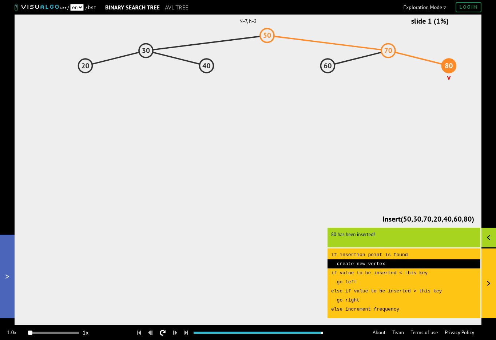
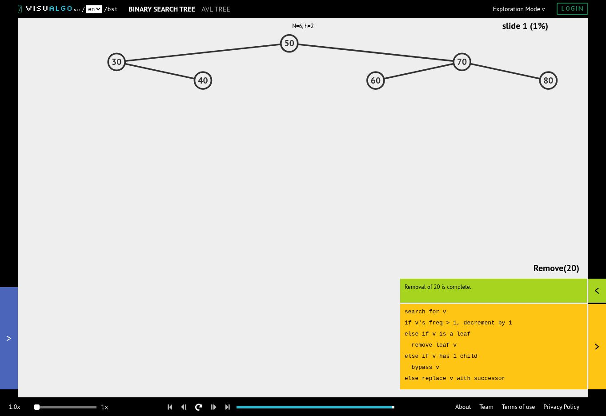
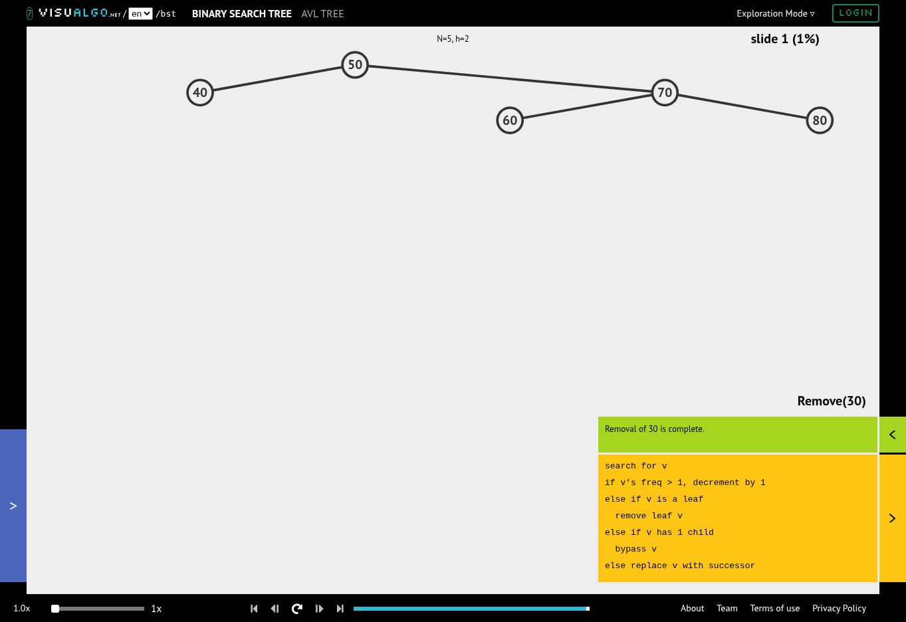
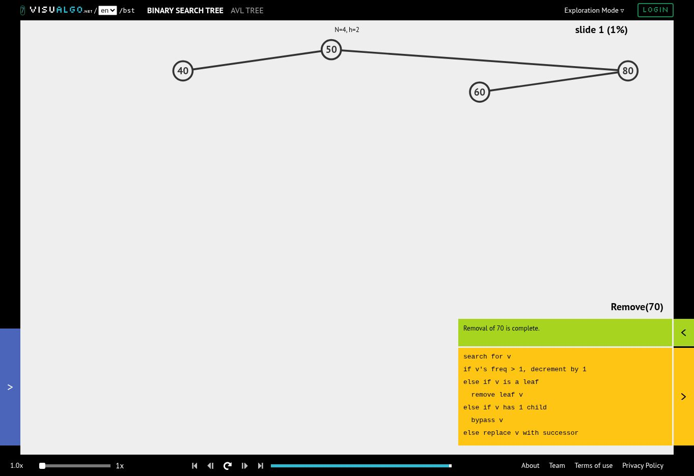
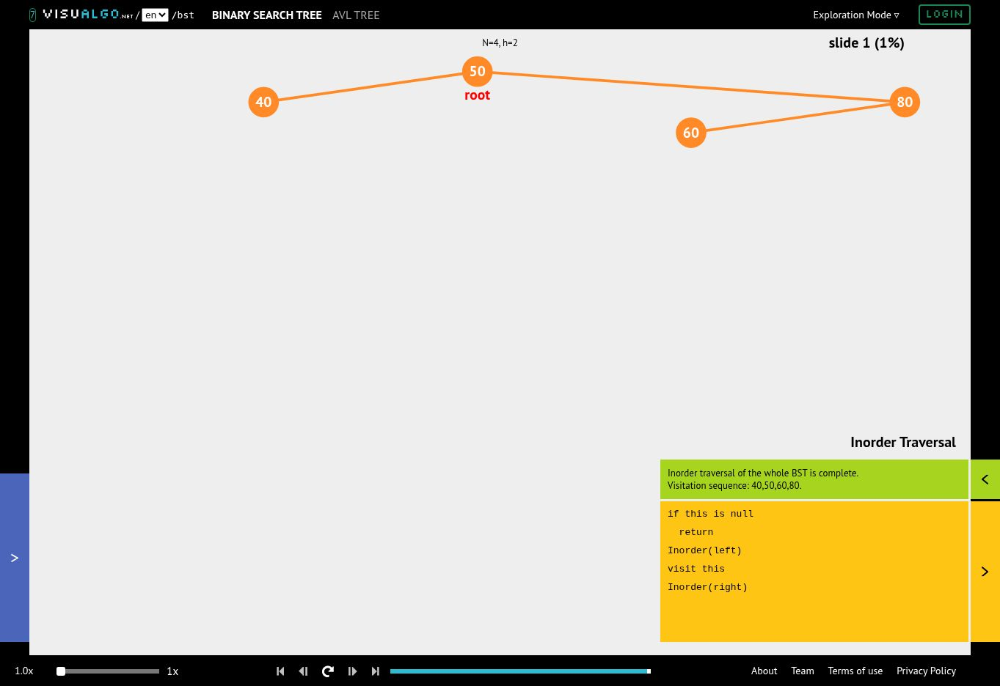

# Week7 — 이진 탐색 트리(BST) 구현 및 성능 분석

## 높이 실험 결과

| n | 최소 가능 높이 | 무작위 높이 | 정렬 높이 |
|---:|---:|---:|---:|
| 100 | 6 | 12 | 99 |
| 1,000 | 9 | 24 | 999 |
| 10,000 | 13 | 29 | 9,999 |

## 탐색 시간 결과

| n | 무작위 탐색 중앙값(ms) | 정렬 탐색 중앙값(ms) | 정렬/무작위 시간비 |
|---:|---:|---:|---:|
| 100 | 0.423194 | 2.133031 | 5.04배 |
| 1,000 | 1.120874 | 25.623600 | 22.86배 |
| 10,000 | 1.919009 | 307.738124 | 160.36배 |

## 성능 분석

n=100·1,000·10,000에서 최소 가능 높이는 각각 6·9·13이고, 무작위 삽입 높이는 12·24·29, 정렬 삽입 높이는 99·999·9,999로 측정되었다. 최소 높이는 노드를 각 레벨에 최대한 채운 경우의 하한이며, 일반 BST의 무작위 삽입은 회전 등으로 균형을 강제하지 않으므로 이보다 높아질 수 있다. 오름차순 삽입에서는 모든 새 키가 기존 키보다 커 오른쪽 사슬이 생기므로 높이가 n−1이 되고, 탐색의 최악 시간은 O(n), 전체 트리 구성 시간은 O(n²)가 된다. 각 크기에서 동일한 1,000개 성공 탐색 대상을 사용한 결과, n=10,000의 무작위·정렬 탐색 중앙값은 각각 1.919009ms·307.738124ms로 정렬 삽입 트리가 약 160.36배 오래 걸렸다. 무작위 순열 삽입의 기대 연산 시간은 O(log n)이지만 최악의 균형을 보장하지 않으며, 이 실험의 시간비는 고정된 입력·실행 환경에서의 관측값이므로 이론적 시간 복잡도 자체나 모든 환경의 성능비를 뜻하지 않는다.

## 시간 측정 조건

| 항목 | 조건 |
|---|---|
| 실행 환경 | Python 3.12.14 / Linux x86_64; 사용자의 Colab이 아닌 검증용 Python 환경 |
| 입력 크기 | n = 100, 1,000, 10,000 |
| 키 집합 | 각 크기에서 양쪽 모두 list(range(n)); 중복 없는 같은 키 집합 |
| 무작위 삽입 | random.Random(7).shuffle(values) |
| 정렬 삽입 | 오름차순으로 insert_iterative를 실제 n회 호출 |
| 탐색 대상 | [random.Random(17+i).randrange(n) for i in range(1000)]; 타깃 중복 가능 |
| 탐색 유형 | 모두 존재하는 키의 성공 탐색; 같은 크기의 두 트리에 같은 목록 사용 |
| 측정 구간 | search_iterative로 1,000개 목록 전체를 탐색하는 시간; 단일 탐색 시간이 아님 |
| 워밍업·반복 | 목록 전체 1회 워밍업 후 5회 측정한 중앙값 |
| 타이머 | time.perf_counter() |
| 측정 제외 | 트리 구성, 타깃 목록 생성, 높이 계산, 검증 assert, 출력 |
| 재귀 제한 | 변경하지 않음; 큰 트리 삽입·탐색·높이는 반복 방식 사용 |

재실행하면 시간은 달라질 수 있다. 고정 시드의 높이는 같은 Python 셔플 결과를 사용하는 환경에서 재현할 수 있다.

## 복잡도 정리

n은 노드 수, h는 간선 기준 높이이다. 재귀 삭제의 후속자 탐색과 제거는 각각 트리 높이 이하이므로 합쳐도 O(h+1)이다.

| 연산 | 시간 | 보조 공간: 반환 결과 제외 |
|---|---|---|
| 재귀 탐색·삽입·삭제 | O(h+1) | O(h+1) |
| 반복 탐색·삽입 | O(h+1) | O(1); 삽입으로 만드는 새 노드 공간은 별도 |
| 중위 순회 | O(n) | O(h+1); 반환 리스트는 별도 O(n) |
| 재귀 높이·노드 수 | O(n) | O(h+1) |
| 반복 높이 계산 | O(n) | O(h+1) 상한; 오른쪽 사슬에서는 O(1) |
| 전체 BST 구성: 무작위 순열 | 기대 O(n log n), 최악 O(n²) | 생성 노드 O(n) |
| 전체 BST 구성: 정렬된 서로 다른 키 | O(n²) | 생성 노드 O(n) |
| Tree Sort | 기대 O(n log n), 최악 O(n²) | 트리·출력 O(n) |

현재 중복 삽입을 무시하므로 중복을 보존하는 정렬이 필요하면 빈도 카운터 등의 정책이 필요하다. 무작위 순열의 기대 높이는 O(log n)이지만 일반 BST는 최악의 높이 O(n)을 가질 수 있다. 최소 높이는 n>=1에서 ceil(log2(n+1))−1 = n.bit_length()−1이며, 빈 트리는 별도 규약으로 -1이다.

## 선택 심화·시각화

#### 1. 삽입 완료



50, 30, 70, 20, 40, 60, 80을 순서대로 삽입한 결과이다. 루트는 50이고 노드 수는 7, 높이는 2이다.

#### 2. 리프 노드 20 삭제



20에는 자식이 없으므로 부모 30의 왼쪽 링크를 None으로 바꿔 제거한다. 삭제 후 노드 수는 6이다.

#### 3. 자식 하나인 노드 30 삭제



앞 단계에서 20을 삭제했으므로 30에는 오른쪽 자식 40만 남는다. 50의 왼쪽 링크를 40으로 연결하여 30을 우회하며, 노드 수는 5가 된다.

#### 4. 자식 둘인 노드 70 삭제



70에는 왼쪽 자식 60과 오른쪽 자식 80이 있다. 중위 후속자인 80으로 70의 자리를 대체하고 기존 후속자 위치를 제거한다. 60은 80의 왼쪽 자식으로 유지되며 노드 수는 4가 된다.

#### 5. 최종 중위 순회



VisuAlgo에 표시된 최종 방문 순서는 40, 50, 60, 80이며 코드의 중위 순회 결과와 일치한다.

### 코드 결과와 비교

배포 노트북의 `BinarySearchTree`와 `make_bst`로 동일한 삽입·삭제를 실행하여 각 단계의 노드와 연결 구조를 대조했다. 아래 중위 순회 결과는 별도로 실행하여 확인했으며, 마지막 결과는 VisuAlgo의 `Visitation sequence`와도 일치했다.

| 단계 | 노드 수 | 중위 순회 결과 | 삭제 유형 |
|---|---:|---|---|
| 삽입 완료 | 7 | `[20, 30, 40, 50, 60, 70, 80]` | — |
| 20 삭제 | 6 | `[30, 40, 50, 60, 70, 80]` | 리프 삭제 |
| 이어서 30 삭제 | 5 | `[40, 50, 60, 70, 80]` | 한 자식: 자식을 부모에 직접 연결 |
| 이어서 70 삭제 | 4 | `[40, 50, 60, 80]` | 두 자식: 중위 후속자로 대체 |

```python
visual_tree = make_bst([50, 30, 70, 20, 40, 60, 80])
print("삽입 완료:", visual_tree.inorder())
for key in [20, 30, 70]:
    visual_tree.delete(key)
    print(f"{key} 삭제:", visual_tree.inorder())
assert visual_tree.inorder() == [40, 50, 60, 80]
```

세 가지 삭제 모두 제거할 값만 제외하고 나머지 키를 보존하며, 중위 순회 결과는 오름차순을 유지한다. 최종 트리의 루트는 50, 왼쪽 자식은 40, 오른쪽 자식은 80이고, 80의 왼쪽 자식은 60이다. 모든 단계의 높이는 간선 기준 2이다.

### 중위 선행자를 이용한 삭제로 확장

현재 노트북은 두 자식 삭제에 **오른쪽 부분 트리의 최솟값인 중위 후속자**를 사용한다. 중위 선행자를 사용하려면 **왼쪽 부분 트리의 최댓값**을 찾아 삭제 대상의 값으로 복사한 뒤, 왼쪽 부분 트리에서 그 선행자를 삭제하고 반환된 부분 트리를 `node.left`에 재연결하면 된다. 선행자는 오른쪽 자식은 없지만 왼쪽 자식을 가질 수 있으므로, 그 자식이 손실되지 않도록 한 자식 삭제 규칙을 적용해야 한다.

예를 들어 20과 30을 삭제한 상태에서 70의 선행자는 60이다. 선행자 방식은 60이 70의 자리를 대신하고 80이 그 오른쪽 자식으로 남으므로, 위 캡처의 후속자 방식과 모양은 달라져도 중위 결과는 똑같이 `[40, 50, 60, 80]`이다. 이는 기존 코드에 적용된 결과가 아니라, 선행자 방식으로 변경할 때의 확장 설계이다.

### 셔플 전처리의 효과와 한계

정렬된 키를 그대로 삽입하면 일반 BST는 높이가 `n−1`인 사슬이 된다. 먼저 키를 균등한 무작위 순열로 섞어 삽입하면 기대 높이가 O(log n)이 되어 기대 탐색·삽입 성능을 개선할 수 있다. 그러나 셔플은 균형 조건을 검사하거나 회전으로 복구하지 않으므로, 불리한 순서가 나올 가능성과 최악 O(n) 높이는 남는다. 또한 셔플 자체의 O(n) 전처리 시간도 필요하며, 최악의 균형을 보장하려면 AVL 트리 등의 균형 유지 구조가 필요하다.

### 부분 트리 크기를 이용한 kth_smallest 확장 설계

각 노드에 `size`를 추가하여 **자기 자신을 포함한 부분 트리의 노드 수**를 저장하고, 빈 자식의 크기는 0으로 둔다. 저장 규칙은 `size = 1 + size(left) + size(right)`이며, k는 1부터 시작한다. 현재 노드의 왼쪽 부분 트리 크기를 L이라고 하면 다음처럼 진행한다.

| 조건 | 다음 동작 |
|---|---|
| `k <= L` | 왼쪽 자식으로 이동 |
| `k == L + 1` | 현재 노드의 값을 반환 |
| `k > L + 1` | `k -= L + 1`로 바꾸고 오른쪽 자식으로 이동 |

삽입·삭제로 자식 연결이 바뀔 때마다 해당 경로를 따라 `size`를 다시 계산해야 한다. 특히 두 자식 삭제에서는 후속자 또는 선행자를 실제로 제거한 경로의 크기도 갱신해야 하며, 중복 삽입 무시와 없는 키 삭제는 크기를 바꾸지 않는다. k가 `1 <= k <= size(root)`를 벗어나면 유효하지 않은 순위로 처리한다. 예시 삽입 트리의 세 번째 작은 값은 40이고, 20·30·70을 삭제한 최종 트리의 세 번째 작은 값은 60이다.
