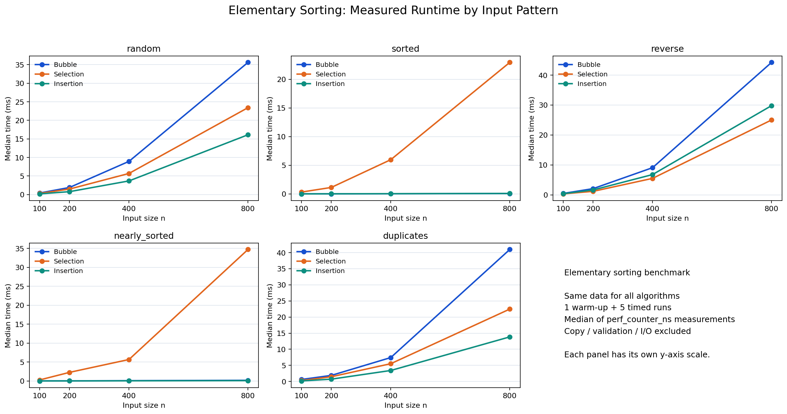

# Week9 — 기본 정렬 구현 및 비교

## 제출 파일과 실행

강의의 제출처는 **LMS**이며, GitHub Week9는 파일을 정리하고 결과를 확인하는 공간이다. 제출 기본 항목은 노트북·benchmark.csv·benchmark.png·분석문이며, 실습 예제의 구현 파일 세 개도 함께 제공한다.

**제출 전 본인 Colab에서 `DS_09배포용 (1).ipynb`를 열고 위에서 아래로 모두 실행한다.** 노트북은 현재 실행 결과로 CSV·PNG·analysis.md를 다시 생성한다. 이 묶음에 저장된 값은 검증용 Python 환경에서 실제 측정한 것이며, 수업이 요구한 제출자 본인 환경의 실측값을 대신한다고 주장하지 않는다. 재실행한 파일을 내려받아 교체하고, 노트북도 실행 출력이 포함된 상태로 저장한다.

| 파일 | 용도 |
|---|---|
| `DS_09배포용 (1).ipynb` | 세 정렬 구현·정확성·추적·안정성·연산 수·실험·분석 |
| [benchmark.csv](benchmark.csv) | 중앙값·최솟값·최댓값 요약 60행; ms |
| [benchmark_samples.csv](benchmark_samples.csv) | 개별 측정 300행; ms |
| [benchmark.png](benchmark.png) | 입력 유형별 실제 측정 그래프 |
| [analysis.md](analysis.md) | 현재 실행값과 시간비를 사용한 다섯 문항 분석 |
| [practice_examples.md](practice_examples.md) | 실습 예제 4문제의 구현·안정성·패스·역전쌍 설명 |
| `boj2750_bubble.py`, `boj2750_selection.py`, `boj2750_insertion.py` | 독립 실행 가능한 세 기본 정렬 풀이 |
| [09.html](09.html) | 첨부된 정렬 7종 애니메이션 원본 |
| [test_results.txt](test_results.txt) | 코드 실행 출력과 로컬 I/O 검증 결과 |

## 실제 측정 그래프

각 패널은 독립적인 y축 범위를 사용한다. 정렬·거의 정렬에서는 버블과 삽입이 선택 정렬에 비해 매우 짧게 측정될 수 있으므로 정확한 값은 CSV로 확인한다. 보고서의 시간비는 CSV에서 계산하며, 이 한 번의 실험만으로 점근 복잡도를 증명하지 않는다.

`09.html`은 일곱 정렬을 시각화하는 참고 자료이다. 표시 시간에는 애니메이션 대기와 화면 갱신이 포함되므로 Python 공정 벤치마크의 숫자로 사용하지 않는다. 9주차에서는 그중 버블·선택·삽입의 움직임을 관찰한다.

## 공통 구현 계약과 검증

`sort(a, key=...)`는 a 자체를 오름차순으로 바꾸고 동일한 리스트 객체를 반환한다. 핵심 정렬에는 sorted/list.sort를 사용하지 않고 정답 검증에서만 사용했다. 빈 입력·단일·중복·음수·정렬·역순·고정 시드 무작위 입력의 **알고리즘별 48개, 총 144개 정확성 사례**를 통과했으며, 순서·원소 보존·동일 객체 반환을 검증했다. 성능 측정의 300회 정렬에서도 결과를 측정 구간 밖에서 확인했다.

## [5,1,4,2,8] 패스 추적

초기 상태는 실제 패스와 구분한다. 버블은 세 번째 패스가 교환 없는 종료 확인이며, 선택과 삽입은 네 패스를 수행한다. 기록용 복사는 정렬 핵심의 O(1) 보조공간이나 성능 측정에 포함하지 않는다.

| 상태 | Bubble | Selection | Insertion |
|---|---|---|---|
| 초기 | `[5, 1, 4, 2, 8]` | `[5, 1, 4, 2, 8]` | `[5, 1, 4, 2, 8]` |
| 패스 1 | `[1, 4, 2, 5, 8]` | `[1, 5, 4, 2, 8]` | `[1, 5, 4, 2, 8]` |
| 패스 2 | `[1, 2, 4, 5, 8]` | `[1, 2, 4, 5, 8]` | `[1, 4, 5, 2, 8]` |
| 패스 3 | `[1, 2, 4, 5, 8]` | `[1, 2, 4, 5, 8]` | `[1, 2, 4, 5, 8]` |
| 패스 4 | 조기 종료 | `[1, 2, 4, 5, 8]` | `[1, 2, 4, 5, 8]` |

## 안정성 확인

| 알고리즘 | 결과: 첫 번째 필드 기준 | A→B 유지 |
|---|---|---|
| Bubble | `[(1, 'C'), (2, 'A'), (2, 'B')]` | 예 |
| Selection | `[(1, 'C'), (2, 'B'), (2, 'A')]` | 아니오 |
| Insertion | `[(1, 'C'), (2, 'A'), (2, 'B')]` | 예 |

버블은 동점 원소를 교환하지 않고 삽입은 엄격히 큰 원소만 이동하므로 동점의 상대 순서를 유지한다. 선택 정렬에서는 (1,C)가 앞의 (2,A)와 멀리 떨어져 교환되면서 A가 B 뒤로 이동한다. 비교 키를 튜플 전체가 아니라 첫 번째 필드로 제한해야 이 차이를 관찰할 수 있다.

## 불변식·복잡도

- 버블: 각 패스 뒤 오른쪽 접미부에 큰 원소가 최종 위치로 확정된다.
- 선택: i 직전에는 앞의 i개가 가장 작은 원소들로 정렬되어 확정되어 있다.
- 삽입: i를 처리하기 직전 a[:i]가 원래 접두부 원소들로 정렬되어 있다.

| 알고리즘 | 최선 | 평균 | 최악 | 보조공간 | 안정성 |
|---|---|---|---|---|---|
| 버블: 조기 종료 | Θ(n) | Θ(n²) | Θ(n²) | O(1) | 안정 |
| 선택: 교환형 | Θ(n²) | Θ(n²) | Θ(n²) | O(1) | 불안정 |
| 삽입: 이동형 | Θ(n) | Θ(n²) | Θ(n²) | O(1) | 안정 |

평균 시간은 무작위 순열 등 일반적인 입력 가정을 전제로 한다. key 호출과 키 비교는 O(1)로 가정하며, 실험용 입력 복사·추적·반환 기록 공간은 핵심 정렬 공간과 구분한다.

## 연산 수와 분석 질문 답안

1. 선택 정렬은 각 패스에서 n−1, n−2, …, 1번 비교하므로 총 비교 횟수는 n(n−1)/2이다. 입력 순서에 관계없이 이만큼 비교하므로 최선·평균·최악 시간이 모두 Θ(n²)이다.
2. 조기 종료 버블은 이미 정렬된 입력에서 첫 패스의 n−1번 비교 후 종료하므로 최선 Θ(n)이다. 역순에서는 합계 n(n−1)/2번의 비교·인접 교환을 하므로 최악 Θ(n²)이다.
3. 삽입 정렬의 오른쪽 이동 한 번은 역전쌍 하나를 해소한다. 따라서 엄격히 큰 값만 이동시키는 이 구현의 shift 횟수는 초기 역전쌍 수와 같다. 같은 값끼리는 역전쌍이 아니다.
4. n=8에서 다음 수치를 실제 계측기로 확인했다. swap과 shift는 서로 다른 단위이며 전체 쓰기 횟수와도 구분한다.

| 알고리즘 | 입력 | 키 비교 | 교환 swap | 오른쪽 이동 shift |
|---|---|---:|---:|---:|
| Bubble | 정렬 | 7 | 0 | 0 |
| Bubble | 역순 | 28 | 28 | 0 |
| Selection | 정렬 | 28 | 0 | 0 |
| Selection | 역순 | 28 | 4 | 0 |
| Insertion | 정렬 | 7 | 0 | 0 |
| Insertion | 역순 | 28 | 0 | 28 |

`O`는 점근적 상한, `Θ`는 같은 차수의 상·하한을 뜻하며, 작은 `o`와 숫자 0은 다른 표기이다. 위 문항의 정확한 차수는 Θ로 기록한다.

## 실측 결과와 다섯 문항 분석

시간 표·입력 크기 두 배의 시간비·정렬 입력의 차이·안정성과 이동 비용·거의 정렬과 역전쌍·이론과 실측의 차이를 [analysis.md](analysis.md)에 정리했다. 노트북에서 재실행하면 분석문도 현재 results를 사용하여 갱신된다.

## 강의·실습 예제 반영

- 강의 자료의 패스·안정성·연산 수·공정 측정 설계를 반영했다.
- 실습 예제의 BOJ 2750은 버블·선택·삽입 세 파일을 모두 제공한다.
- BOJ 10814의 안정성, 1377의 이동 거리와 종료 패스, 1517의 역전쌍은 [practice_examples.md](practice_examples.md)에 연결해 설명했다.
- 온라인 채점이나 LMS 제출을 수행한 상태는 아니며, 제공된 Python 파일은 로컬 입출력으로 검증했다.
